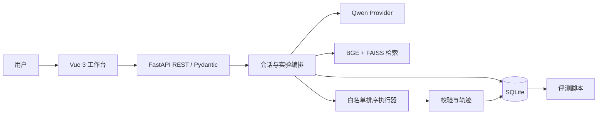
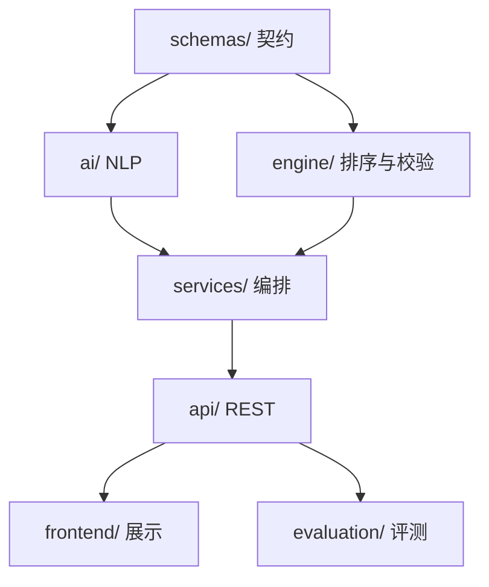
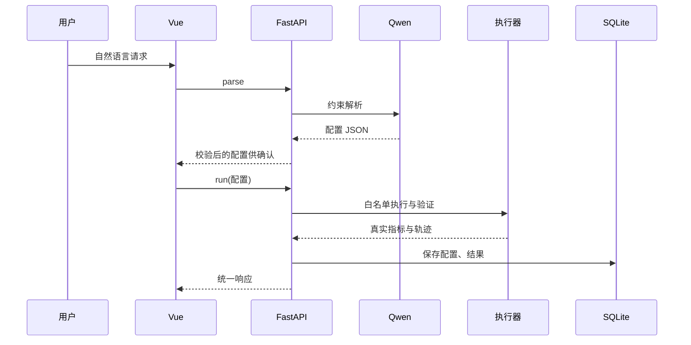
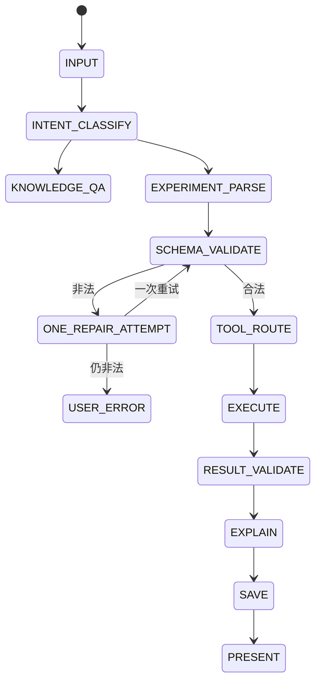
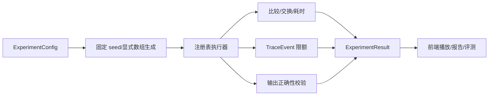

# 系统架构与契约

前端只调用 `/api/v1`；`contracts/openapi.json` 是接口快照，`frontend/src/types/contracts.ts` 从 Pydantic 导出。D1 实际功能为 health、algorithms、run；其余五个约定端点固定返回 501，状态码见 `docs/api-contracts.md`。模型仅生成配置与解释，不执行生成代码，也不产生实测指标。
